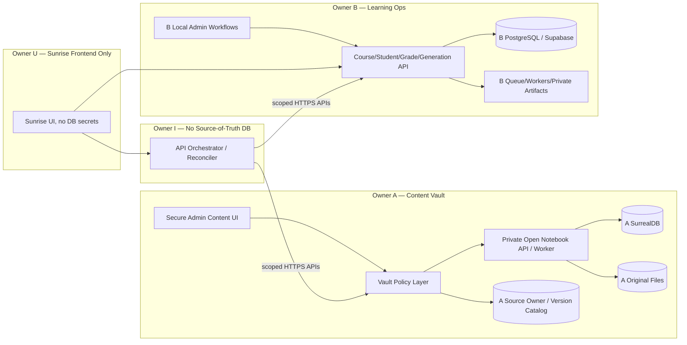

# Reviewed v0.7 — A/B Data Planes + API-only I + U

Both physical Data Planes retain independent backups, credentials, deployment, migrations and owner-local Admin UI. A is original textbook/note/past paper + classification/search, no generated draft/student/grade/marking/weakness. B is academic Course/TeachingGroup, synthetic students, assessment, immutable grades, AI/papers and analytics, no original textbooks. I is API-only; its durable pending work lives in B API Operation Log and A creation journal. U only UI; future features require U Stage to appear in Sunrise.

**S1** uses private Vault Policy Layer to close unprotected upstream Open Notebook admin routes/whole KB scope. **S2** A publishes source/version/licence retention/attestation, Create/Status/Cutover API. **S3** B publishes Course Registry and atomic Reserve/Finalize/Operation Log, even when no A exists; B Course remains `CONTENT_UNLINKED`. **S4** I Link Console performs Create/Adopt and Core Reconciliation; **S5** U branded Course Portal. S6 B Question Schema; S7 B Gemini Key + Model Test; S8 B Generation; S9 I Evidence; S10 U Generation; S11–S14 four individual subject engines. S15–S28 rest follow [Roadmap](../product/ROADMAP.md).

**Known remaining engineering uncertainty:** Open Notebook private API behavior/dedup/upstream upgrade+Security adapter must be verified on pinned image/commit; B Postgres region/cost/Contract concrete schemas before deployment; CORS/provider/privacy and runtime snapshot consistency require actual tests. Current documents do NOT demonstrate a working integration.
